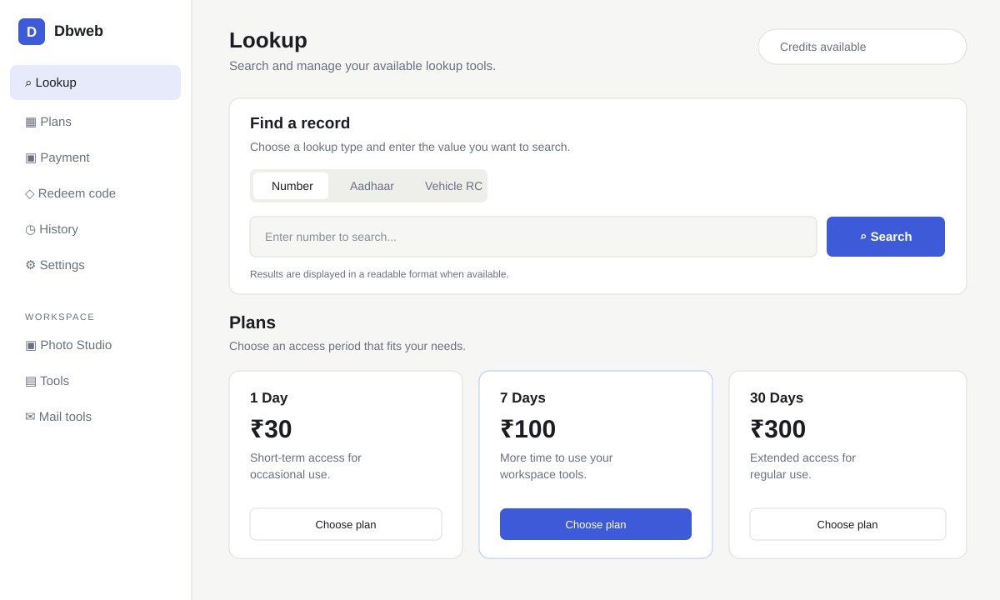
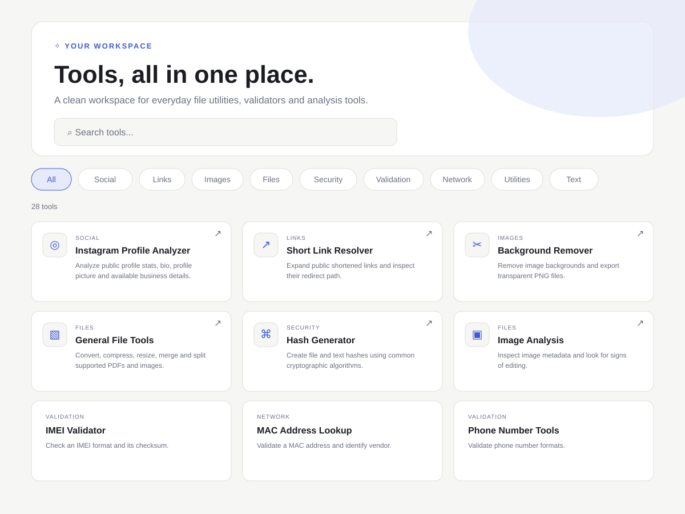
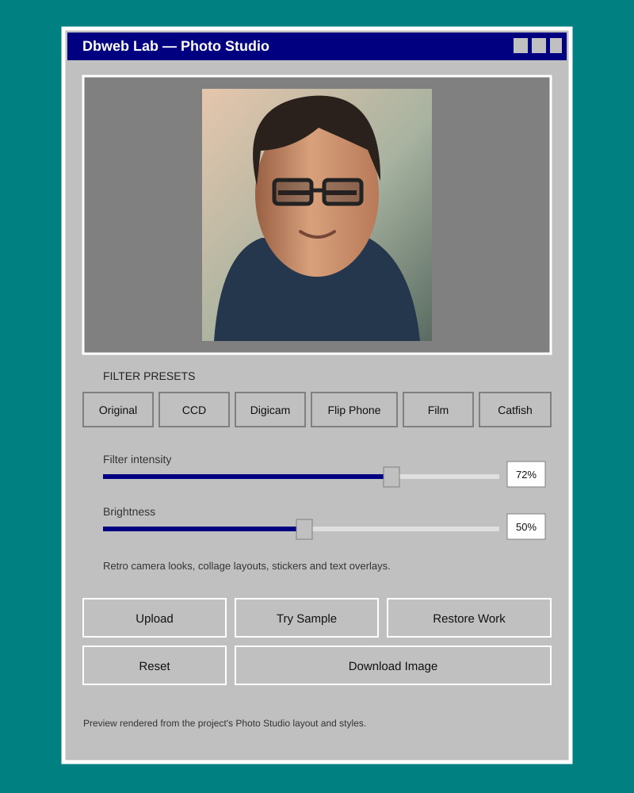

# Dbweb

A responsive web workspace for image editing, background removal, file utilities, validation tools, and everyday productivity.

**Live website:** https://webdd.freeddns.org/


## Website previews

These previews are rendered from the project's own UI layout, styling, and tool names in the repository. The live domain could not be captured from the screenshot environment, so these are source-rendered previews rather than claims of a live-browser screenshot. No stock-photo placeholders are used.

### Main workspace



### Tools directory



### Dbweb Lab — Photo Studio



## About

Dbweb brings several browser-based tools together in one interface, with responsive layouts for desktop and mobile browsers. Features vary by route and may depend on device support or server-side configuration.

### Main areas

- **Main workspace** — lookup interface, plans, payment submission, redeem codes, settings, and history.
- **Dbweb Lab / Photo Studio** — image editing with creative filters, image adjustments, collage tools, stickers, text, and image export.
- **Background Remover** — remove image backgrounds and export transparent PNGs. Compatible browsers try on-device processing first, with an automatic online fallback when needed.
- **Tools directory** — searchable tool cards with category filters, plus a Quick Tools Studio for JSON formatting, Base64 conversion, URL inspection, text case conversion, regex testing, Markdown preview, color conversion, and browser-based image compression.
- **Mail and file utilities** — supported file, text, and productivity workflows.
- **Account and administration screens** — plan, payment-review, and settings workflows where configured.

## Tools included

The tools directory currently lists the following utilities:

| Category | Tools |
| --- | --- |
| Social | Instagram Profile Analyzer |
| Images | Image Compressor |
| Developer | JSON Formatter, Base64 Encoder / Decoder, Regex Tester |
| Web | URL Inspector |
| Text | Text Case Converter, Markdown Preview |
| Design | Color Converter |
| Links | Short Link Resolver |
| Images | Background Remover, Image Analysis |
| Files | General File Tools, File Comparison, Metadata Viewer |
| Security | Hash Generator, Steganography Utility, Signature Checksum, Password Generator |
| Device and network | IMEI Validator, MAC Address Lookup, IP Address Tools |
| Phone and records | Phone Number Tools, Call Record Analysis, IP Record Analysis |
| Image matching | Fingerprint Comparison |
| Validation | Aadhaar Validator, Vehicle Number Decoder, GST Number Validator, PAN Validator |
| Utilities | QR Code Tools, IFSC Lookup, Age & Date Calculator |
| Text | OCR Text Extractor, Text Transliterator, Font Converter |

Tool availability and behavior can change as the project evolves. Use the live website for the latest directory.

## Technology stack

- **JavaScript** for application logic and server-side route handlers
- **JSX** for component-based interface pages
- **HTML** for the standalone Photo Studio and static tools
- **CSS** for responsive layouts, styling, themes, and interaction states
- **Next.js 15** for the web application and route structure
- **React 19** for interactive UI components
- **Lucide icons** for interface icons
- **Node.js and npm** for local development, dependency management, and builds

## Open Dbweb

- **Live website:** https://webdd.freeddns.org/
- **Tools directory:** https://webdd.freeddns.org/tools
- **Photo Studio:** https://webdd.freeddns.org/photo-studio/
- **Background Remover:** https://webdd.freeddns.org/tool

## Getting started

### Requirements

- Node.js 20 or another version supported by the project's dependencies
- npm
- A modern browser
- Internet access for installing dependencies and features that require online processing

### Install

```bash
git clone https://github.com/chatpataprani/Dbweb.git
cd Dbweb
npm install
```

### Configure environment variables

Copy the example configuration for local development:

```bash
cp .env.example .env.local
```

Fill in only the values required for the features you intend to run. Keep private values in local environment settings or your hosting platform's secret settings.

**Never commit real credentials, private keys, passwords, or populated local environment files.**

### Run locally

```bash
npm run dev
```

Open http://localhost:3000 in your browser.

### Build for production

```bash
npm run build
npm start
```

## Background removal workflow

1. Open Background Remover from the tools directory.
2. Select or drop an image into the upload area.
3. Start background removal.
4. The application attempts compatible on-device processing first. If that path is unavailable or fails, it attempts online processing.
5. Preview the result and download the transparent PNG.

On-device processing depends on browser and hardware support. The first run may need to load model assets and can take longer on mobile devices. Online fallback depends on server configuration and availability.

## Project structure

```text
Dbweb/
├── app/
│   ├── bg-remove/           # Background removal page and styles
│   ├── tool/                # Dedicated background removal route
│   │   └── tools/           # Tools directory and tool pages
│       └── quick-tools/ # Browser-based Quick Tools Studio
│   ├── globals.css          # Global styles and themes
│   ├── layout.jsx           # Root application layout
│   └── page.jsx             # Main workspace
├── public/
│   ├── photo-studio/        # Photo Studio HTML, scripts, and assets
│   └── tools/               # Static tool pages and assets
├── docs/
│   └── screenshots/         # Source-rendered UI preview images
├── .env.example             # Environment-variable template
├── package.json
└── README.md
```

The exact directory contents may evolve as features are added or reorganized.

## Deployment

1. Connect the repository to a hosting platform that supports Next.js.
2. Add the required environment variables in the project's secret settings.
3. Run the build command: `npm run build`.
4. Deploy using the platform's recommended Next.js workflow.
5. Check the workspace, Photo Studio, tools directory, and any configured features after deployment.

Changes to environment variables may require a new deployment before they take effect.

## Security and responsible use

- Use the application only for lawful purposes and access only information you are authorized to use.
- Respect privacy, consent, data-protection requirements, and third-party terms.
- Do not use the tools to harass, stalk, impersonate, defraud, expose, or harm another person.
- Keep credentials and server-only secrets out of client-side code.
- Apply suitable access controls, request limits, and monitoring before exposing sensitive features publicly.
- Avoid uploading personal or confidential files unless you have the right to process them.
- Review and test configuration before production deployment.

## Troubleshooting

**The app does not start**
- Confirm your Node.js and npm versions.
- Run `npm install` again if dependencies are missing.
- Review the first build or runtime error in the terminal output.

**A feature reports missing configuration**
- Check the environment settings for the deployment.
- Confirm variable names match the example configuration.
- Redeploy after changing hosted environment variables.

**Background removal falls back or fails**
- Try an up-to-date browser on a compatible device.
- Use a smaller image if memory is limited.
- Confirm that online processing is configured if on-device processing cannot run.

## Contributing

Contributions and bug reports are welcome.

1. Fork the repository.
2. Create a focused branch for your change.
3. Avoid committing secrets or private user data.
4. Test the affected feature and run `npm run build` where possible.
5. Open a pull request describing the change and tests performed.

## License

This project is licensed under the MIT License. See [LICENSE](LICENSE) for the full text.

---

For bugs or feature requests, open an issue in this repository and include the steps needed to reproduce the problem. Do not include passwords, access tokens, private keys, or personal data in an issue.
